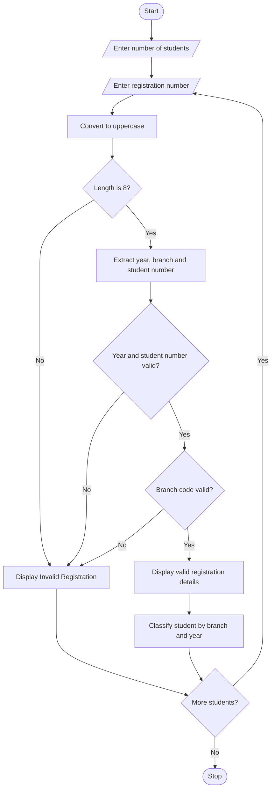

# Case Study No. 33: Campus Registration Identifier Analyzer

**Student Name:** Mahesh Pedasingu  
**Roll Number:** 26000279

**Key concepts:** string slicing, format validation, dictionary lookup, and extracting structured information from an identifier.

## 1. Problem Statement

Develop a Python program to analyze student registration identification numbers. The program should validate the structure of each registration number, extract important details such as admission year, branch code, and student number, and classify students according to their branch and admission year.

The program should identify invalid registration numbers and display the extracted information for valid records.

## 2. Assumptions

For this example, the registration number follows this format:

`YYBBBSSS`

| Part | Meaning        | Example |
| ---- | -------------- | ------- |
| YY   | Admission year | 25      |
| BBB  | Branch code    | CSE     |
| SSS  | Student number | 001     |

Branch codes:

- CSE – Computer Science Engineering
- ECE – Electronics and Communication Engineering
- EEE – Electrical and Electronics Engineering
- MEC – Mechanical Engineering
- CIV – Civil Engineering

Example: `25CSE001`

## 3. Algorithm

1. Start the program.
2. Enter the number of student records.
3. Read each student's registration number.
4. Convert the registration number into uppercase.
5. Check whether the registration number contains exactly 8 characters.
6. Extract the admission year, branch code, and student number.
7. Validate the admission year and student number.
8. Check whether the branch code is valid.
9. If all conditions are satisfied, classify the student.
10. Display the extracted details.
11. If the registration number is invalid, display an error message.
12. Repeat for all students.
13. Stop the program.

## 4. Flowchart



## 5. Python Source Code

```python
branches = {
    "CSE": "Computer Science Engineering",
    "ECE": "Electronics and Communication Engineering",
    "EEE": "Electrical and Electronics Engineering",
    "MEC": "Mechanical Engineering",
    "CIV": "Civil Engineering"
}

n = int(input("Enter number of students: "))

for i in range(n):

    reg = input("\nEnter registration number: ")
    reg = reg.strip().upper()

    if len(reg) == 8:

        year = reg[0:2]
        branch = reg[2:5]
        student_no = reg[5:8]

        if (year.isdigit() and
            student_no.isdigit() and
            branch in branches and
            int(year) >= 1 and
            int(student_no) >= 1):

            print("\nValid Registration Number")
            print("Admission Year: 20" + year)
            print("Branch Code:", branch)
            print("Branch Name:", branches[branch])
            print("Student Number:", student_no)

        else:
            print("Invalid Registration Number")

    else:
        print("Invalid Registration Number")
```

## 6. Sample Input

```
Enter number of students: 3

Enter registration number: 25CSE001

Enter registration number: 24ECE015

Enter registration number: 25ABC123
```

## 7. Sample Output

```
Valid Registration Number
Admission Year: 2025
Branch Code: CSE
Branch Name: Computer Science Engineering
Student Number: 001

Valid Registration Number
Admission Year: 2024
Branch Code: ECE
Branch Name: Electronics and Communication Engineering
Student Number: 015

Invalid Registration Number
```

## 8. Additional Test Cases

| Test case | Registration number | Expected result        |
| --------- | ------------------- | ---------------------- |
| 1         | 25CSE001            | Valid                  |
| 2         | 24ECE015            | Valid                  |
| 3         | 25EEE020            | Valid                  |
| 4         | 25ABC123            | Invalid branch         |
| 5         | 25CSE01             | Invalid length         |
| 6         | 2ACSE001            | Invalid year           |
| 7         | 25MEC000            | Invalid student number |

 

## 10. Conclusion

The Campus Registration Identifier Analyzer helps validate student registration numbers and extract important information such as admission year, branch code, and student number. It identifies invalid registration numbers and classifies valid students according to their branches. This program demonstrates Python strings, string slicing, dictionaries, loops, and conditional statements.

Python concepts used:

- Variables and data types
- Strings and string methods
- String slicing
- Dictionaries
- For loops
- If-else statements
- Logical operators
 
