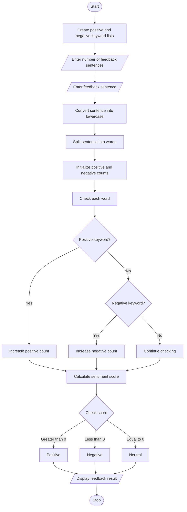

# Case Study No. 34: Student Feedback Sentiment Scoring

**Student Name:** Mahesh Pedasingu  
**Roll Number:** 26000279

**Key concepts:** keyword matching, counters, sentiment scoring, and rule-based text classification.

## 1. Problem Statement

Develop a Python program to analyze multiple student feedback sentences using a predefined list of positive and negative keywords.

The program should identify positive and negative words in each feedback sentence, count the keywords, calculate the sentiment score, and classify the feedback as Positive, Negative, or Neutral based on predefined conditions.

## 2. Algorithm

1. Start the program.
2. Create a list of positive keywords.
3. Create a list of negative keywords.
4. Enter the number of feedback sentences.
5. Read each student's feedback.
6. Convert the feedback into lowercase.
7. Split the feedback into individual words.
8. Initialize positive and negative counts to zero.
9. Compare each word with the positive and negative keyword lists.
10. Increase the positive or negative count accordingly.
11. Calculate the sentiment score by subtracting negative count from positive count.
12. Classify the feedback:
    - Score greater than zero: Positive.
    - Score less than zero: Negative.
    - Score equal to zero: Neutral.
13. Display the feedback, keyword counts, score, and classification.
14. Stop the program.

## 3. Flowchart


## 4. Python Source Code

 
```python
positive = ["good", "excellent", "helpful",
            "amazing", "wonderful"]

negative = ["bad", "poor", "difficult",
            "boring", "worst"]

n = int(input("Enter number of feedback sentences: "))

for i in range(n):

    feedback = input("\nEnter feedback: ")

    words = feedback.lower().split()

    pos_count = 0
    neg_count = 0

    for word in words:

        word = word.strip(".,!?")

        if word in positive:
            pos_count += 1

        elif word in negative:
            neg_count += 1

    score = pos_count - neg_count

    if score > 0:
        result = "Positive"

    elif score < 0:
        result = "Negative"

    else:
        result = "Neutral"

    print("\n----- FEEDBACK RESULT -----")
    print("Feedback:", feedback)
    print("Positive Keywords:", pos_count)
    print("Negative Keywords:", neg_count)
    print("Sentiment Score:", score)
    print("Classification:", result)
```

## 5. Sample Input

```
Enter number of feedback sentences: 3

Enter feedback: The AI class was excellent and helpful.

Enter feedback: The examination was difficult and boring.

Enter feedback: The classroom is good but the teaching was poor.
```

## 6. Sample Output

```
----- FEEDBACK RESULT -----
Feedback: The AI class was excellent and helpful.
Positive Keywords: 2
Negative Keywords: 0
Sentiment Score: 2
Classification: Positive

----- FEEDBACK RESULT -----
Feedback: The examination was difficult and boring.
Positive Keywords: 0
Negative Keywords: 2
Sentiment Score: -2
Classification: Negative

----- FEEDBACK RESULT -----
Feedback: The classroom is good but the teaching was poor.
Positive Keywords: 1
Negative Keywords: 1
Sentiment Score: 0
Classification: Neutral
```

## 7. Additional Test Cases

| Test case | Positive count | Negative count | Score | Result   |
| --------- | -------------- | -------------- | ----- | -------- |
| 1         | 3              | 0              | 3     | Positive |
| 2         | 0              | 2              | -2    | Negative |
| 3         | 1              | 1              | 0     | Neutral  |
| 4         | 2              | 1              | 1     | Positive |
| 5         | 0              | 0              | 0     | Neutral  |

 

 
## 9. Conclusion

The Student Feedback Sentiment Scoring program analyzes multiple feedback sentences using predefined positive and negative keywords. It counts the keywords, calculates the sentiment score, and classifies feedback as Positive, Negative, or Neutral. This program demonstrates the use of Python strings, lists, loops, conditional statements, and arithmetic operators.

